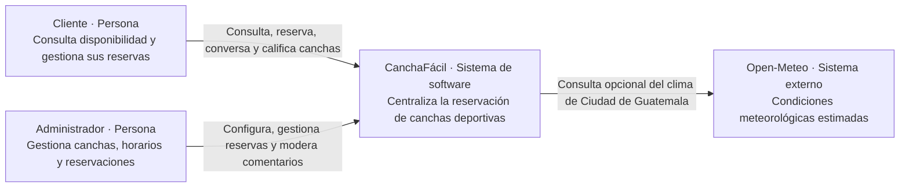
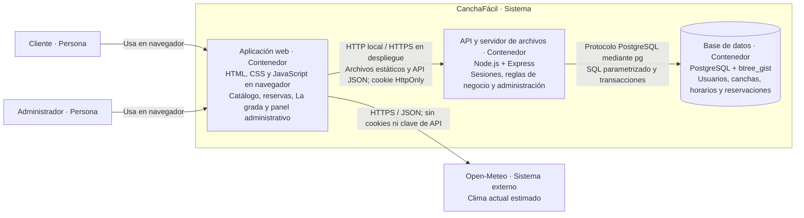
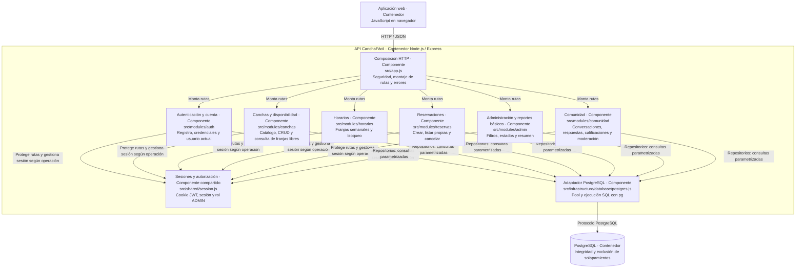
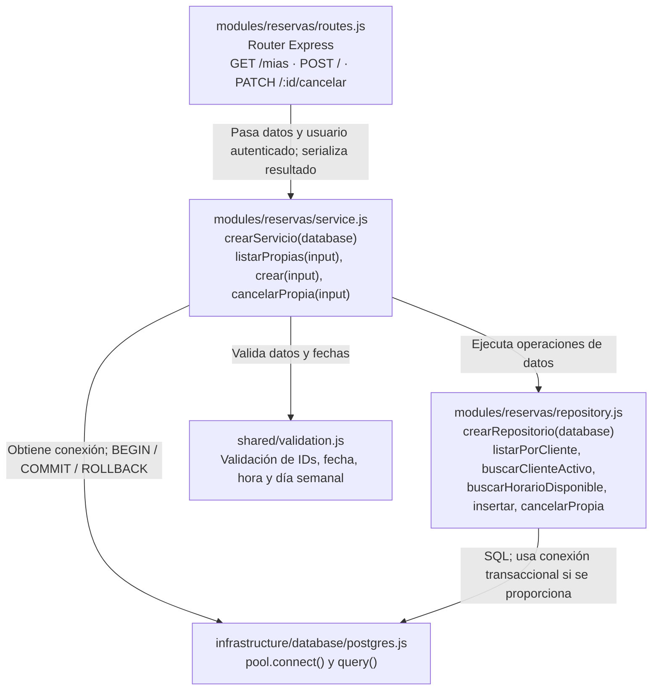
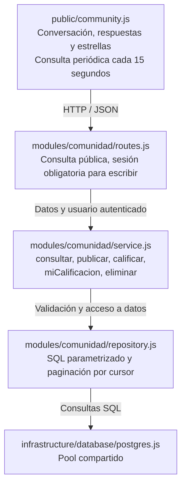

# Arquitectura C4 de CanchaFácil

Estado: actualizado el 21 de octubre de 2026 con la comunidad La grada y el diseño Luna. El sistema conserva Node.js, Express, PostgreSQL y la interfaz HTML/CSS/JavaScript de la Parte 4. Las figuras usan Mermaid para poder revisarse junto al código.

## Decisión de arquitectura

CanchaFácil es un sistema cliente-servidor con un backend monolítico modular. Cada módulo separa adaptación HTTP, servicios de aplicación y repositorios SQL. Los seis módulos se ejecutan en el mismo proceso Node.js y comparten PostgreSQL.

C4 describe distintos niveles de la misma solución: contexto, contenedores, componentes y código. Un contenedor C4 es una aplicación o almacén de datos; no implica usar Docker. Referencia: [modelo C4 oficial](https://c4model.com/diagrams), [contenedores](https://c4model.com/abstractions/container) y [componentes](https://c4model.com/abstractions/component).

## C1. Contexto del sistema

Alcance: CanchaFácil completo. Público: equipo, usuarios y docente. Los actores interactúan con un único sistema; los detalles tecnológicos aparecen en C2.



El MVP trabaja con CLIENTE y ADMIN. Pagos, facturación, mensajería externa y el rol opcional de encargado permanecen fuera del alcance de esta versión.

## C2. Contenedores

Alcance: aplicaciones y persistencia de CanchaFácil. Público: equipo técnico. Las flechas describen quién inicia cada interacción; las respuestas vuelven por la misma conexión.



La web se ejecuta en el navegador y sus archivos son entregados por Express desde `public/`. El backend es un único despliegue. HTTPS requiere configuración del entorno de despliegue; el servidor local escucha HTTP. Git/GitHub son herramientas de desarrollo y no participan en el flujo de reservas.

## C3. Componentes del backend

Alcance: contenedor API. Público: desarrolladores. Cada componente funcional agrupa sus rutas, servicio y repositorio. Las flechas hacia el adaptador de persistencia representan llamadas de sus repositorios; los módulos no llaman a las rutas de otros módulos.



Las utilidades `shared/validation.js` y `shared/http.js` se usan dentro de los componentes y se omiten de la figura para facilitar su lectura. Los repositorios contienen el SQL y reciben el adaptador al crear el servicio. Durante la creación de una reserva reciben la misma conexión transaccional.

El diseño de la Parte 3 menciona usuarios, reportes y disponibilidad como responsabilidades. En este MVP, cuenta de usuario pertenece a `auth`, reportes básicos a `admin` y disponibilidad a `canchas`. No existen CRUD de usuarios ni un generador independiente de reportes. Esta agrupación refleja las funciones implementadas y permite extraerlas en el futuro si crecen.

## C4. Código del componente Reservaciones

Alcance: implementación del componente de reservaciones, con dependencias de soporte. Público: desarrolladores. Los bloques representan módulos CommonJS y funciones reales; no son clases añadidas al proyecto.



### Flujo de creación y concurrencia

1. La ruta exige sesión y pasa el ID del usuario autenticado; no toma el cliente del formulario.
2. El servicio valida IDs y fecha, obtiene una conexión e inicia la transacción.
3. El repositorio consulta la cuenta activa y la franja de una cancha activa; el servicio comprueba día y hora.
4. El repositorio inserta la reserva con sus horas históricas. PostgreSQL vuelve a garantizar que no exista cruce mediante `reservas_sin_solapamiento`, incluso ante solicitudes simultáneas.
5. El servicio confirma; ante fallo revierte y libera la conexión. El manejador HTTP traduce `23P01` a HTTP 409.

Cancelar cambia el estado conservando el historial; la restricción SQL solo considera PENDIENTE y CONFIRMADA. La siguiente consulta de disponibilidad vuelve a considerar libre la franja cancelada.

## C4. Código del componente Comunidad



La grada es una ampliación funcional del monolito; no agrega otro proceso ni proveedor externo. Los mensajes se actualizan cada 15 segundos mientras la conversación está visible. La interfaz deja de consultar al salir. No se afirma que exista WebSocket ni entrega instantánea.

`calificaciones_cancha` tiene clave primaria `(cancha_id, usuario_id)` y puntuación de 1 a 5: actualizar una calificación sustituye el voto de esa cuenta. `comentarios_cancha` conserva mensajes y respuestas, con clave foránea compuesta para impedir responder a otra cancha. La eliminación es lógica y mantiene los hilos. La consulta pagina 30 mensajes y devuelve nombres de pila, sin correos ni teléfonos.

Lectura pública; publicación y calificación requieren una cuenta activa y una cancha activa. Solo el autor o ADMIN puede eliminar un comentario. Una cancha inactiva conserva su conversación en modo lectura. Los textos se muestran escapados en el navegador y las consultas usan parámetros.

El catálogo obtiene el promedio y número de votos mediante una consulta agregada a PostgreSQL. Ese acceso de lectura entre datos funcionales es deliberado en este monolito; `canchas` no llama a las rutas de `comunidad`.

El frontend separa `theme.js` (preferencia persistente y tema del sistema), `selects.js` (selectores personalizados con teclado), `community.js` (conversación) y `app.js` (composición y flujos existentes). `luna.css` define la paleta y las superficies claras y oscuras; `chat.css` define la conversación, buscador y compositor. Los borradores del chat se almacenan por cuenta y cancha en el navegador, sin cambiar la persistencia de mensajes en PostgreSQL. La búsqueda se limita a los mensajes cargados. El aviso de mensajes nuevos conserva la posición de lectura. El tema se guarda en el dispositivo mediante almacenamiento local opcional y no modifica la sesión del servidor.

## Organización del código y reglas de dependencia

El footer compartido (`public/footer.js`, `public/footer.css`) pertenece al contenedor web: reutiliza la API de canchas para mostrar cantidad y deportes, y los flujos de navegación existentes. No constituye un nuevo componente de backend ni un sistema externo.

El cierre agrega `public/forms.js` y `public/polish.css` como adaptación de presentación: validación accesible, errores junto a los campos, estado de envío, protección contra clics repetidos y agrupación visual del chat por día. Los servicios mantienen las reglas de negocio. `shared/validation.js` compara horas como segundos para evitar diferencias entre HH:MM y HH:MM:SS. PostgreSQL impone también `horarios_activos_sin_solapamiento` para impedir franjas semanales activas superpuestas ante escrituras concurrentes.

`scripts/start-local.js` coordina el arranque local; `scripts/database-tools.js` exporta y restaura copias. Son herramientas operativas del proyecto, no nuevos contenedores ni endpoints de negocio. Véanse [Entrega](Entrega.md) y [Respaldos](Respaldos.md).

```text
src/
  server.js                       Configuración y apertura del puerto
  app.js                          Fábrica createApp y composición HTTP
  modules/
    auth/                         Registro, sesión y cuenta
    canchas/                      Catálogo, gestión y disponibilidad
    horarios/                     Franjas semanales y bloqueo
    reservas/                     Reservas del cliente
    admin/                        Estados, filtros y resumen
    comunidad/                    Conversaciones, respuestas y valoraciones
      routes.js                   Adaptación Express y autorización
      service.js                  Casos de uso y validaciones
      repository.js               SQL parametrizado
  infrastructure/database/
    postgres.js                   Adaptador pg y pool compartido
  shared/
    session.js                    Cookies, JWT y permisos
    validation.js                 Funciones de validación
    http.js                       Errores y adaptación HTTP
  routes/, lib/, db.js             Reexportaciones de compatibilidad
public/                           Aplicación web existente
database/schema.sql               Integridad de datos y exclusión GiST
```

Los tres archivos `routes.js`, `service.js` y `repository.js` existen en cada módulo. Las rutas deciden estado HTTP, cookies y acceso; los servicios reciben objetos de datos y devuelven resultados sin usar `req` ni `res`; los repositorios ejecutan SQL sin decidir respuestas HTTP. La fábrica del servicio recibe el adaptador, por lo que las pruebas pueden sustituirlo sin conectar a PostgreSQL. Los servicios usan `HttpError` como error con estado para conservar el contrato existente; esta es una dependencia compartida deliberada del MVP.

`src/routes/`, `src/lib/` y `src/db.js` conservan importaciones anteriores mediante reexportación, sin duplicar lógica. El comando de inicio es `npm start`, que ejecuta `src/server.js`. Importar `createApp` no abre un puerto; para construir la app completa sigue siendo necesario configurar DATABASE_URL y el entorno de sesión.

## Relación con las entregas anteriores

- Fase 1: actores, RF-01 a RF-13 y RN-01 a RN-06 delimitan el sistema en C1 y las responsabilidades funcionales.
- Parte 2: HU-01 a HU-12 se conservan en la [trazabilidad SDD](SDD_Trazabilidad.md), ahora enlazada a los módulos.
- Parte 3: se mantiene presentación, aplicación y persistencia; C2 y C3 detallan la implementación actual.
- Horarios: el diseño preliminar por fecha se concretó en franjas semanales (`dia_semana`); cada reserva guarda fecha y horas. El esquema actual es la referencia ejecutable.
- Interfaz: la base usa CSS propio; Bootstrap aparecía en el diseño preliminar y no es una dependencia actual.
- Persistencia: se mantiene `pg`, ya utilizado en la base, y Sequelize continúa sin incorporarse.

## Verificación y límites

Ejecutar `npm test` para validaciones, reglas de reservación, transacciones con adaptador simulado y contrato HTTP básico. Los dobles de prueba comprueban la orquestación; no prueban la exclusión real de PostgreSQL. Los escenarios [PM-01 a PM-15](Pruebas_Manuales.md), especialmente PM-05 y PM-06 de concurrencia, requieren una base configurada y evidencia real.

Actualizar estas figuras cuando se agregue un contenedor, cambie una responsabilidad o se altere una dependencia. C4 describe esta implementación; no declara completadas funciones o pruebas pendientes.
